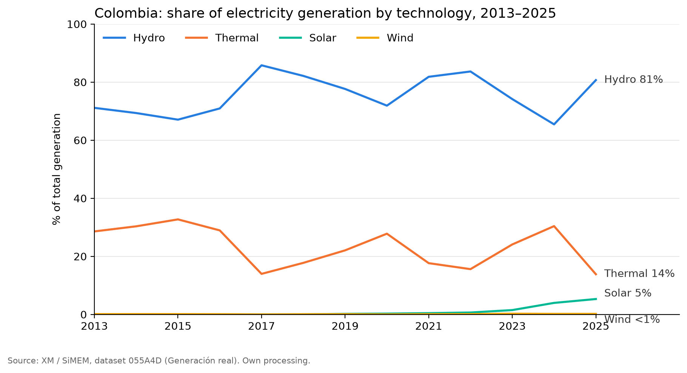
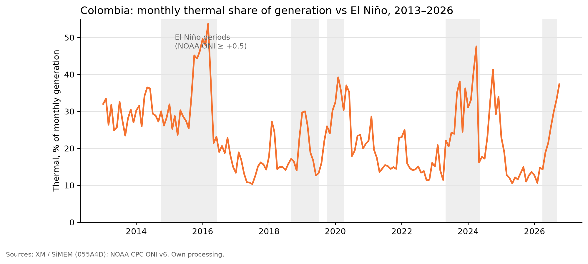

# Colombia's power mix: hydro dependence, El Niño and the rise of solar (2013–2026)

An analysis of Colombia's electricity generation built from plant-level, hourly data published by the grid operator, XM. The project looks at three questions:

1. How dependent is Colombia on hydropower, and how has the generation mix changed over the last decade?
2. Can the effect of El Niño droughts be seen in the data, with thermal plants filling the gap left by hydro?
3. How fast is solar growing, and how does that compare with the rest of Latin America? *(in progress)*

> **Status:** Questions 1 and 2 are complete. The regional comparison (question 3, using EIA international data) and the split of thermal generation into gas and coal are in progress.

## Key findings so far

**Hydro dominates, and the weather decides by how much.** Between 2013 and 2025, hydro supplied between 65% and 86% of Colombia's electricity each year. The swings follow the climate rather than any policy trend: hydro was 67% in 2015 and 81% in 2025. Total generation grew from 62 TWh in 2013 to 84 TWh in 2025.

**Every El Niño since 2014 pushed thermal generation sharply up.** Comparing each episode with the 12 months before it:

| El Niño episode | Thermal share, 12 months before | Peak thermal share | Peak month | Rise |
|---|---|---|---|---|
| 2014–16 | 30.5% | 53.7% | Mar 2016 | +23.2 pp |
| 2018–19 | 17.1% | 30.0% | Feb 2019 | +12.9 pp |
| 2019–20 | 19.9% | 39.2% | Feb 2020 | +19.3 pp |
| 2023–24 | 14.3% | 47.6% | Apr 2024 | +33.3 pp |
| 2026 (ongoing) | 12.5% | 37.4%* | Oct 2026* | +24.9 pp* |

\* Latest month available, not necessarily the peak.

Peaks arrive towards the end of each episode, between February and April, when El Niño overlaps with Colombia's dry season and reservoirs are at their lowest.

**Solar has only just started.** Solar went from 0.7% of generation in 2022 to 5.3% in 2025 (4.5 TWh). Wind remains marginal at 0.2%.





## Data sources

| Source | What | Coverage |
|---|---|---|
| [SiMEM](https://www.simem.co) (XM), dataset `055A4D` "Generación real" | Hourly generation per plant, kWh | Jan 2013 – Oct 2026 |
| SiMEM (XM), dataset `670221` "Listado de unidades de generación" | Technology of each generation unit | Monthly snapshots, 2013–2026 |
| [NOAA CPC, Oceanic Niño Index v6](https://www.cpc.ncep.noaa.gov/products/analysis_monitoring/enso/oni/v6/) | El Niño periods (ONI ≥ +0.5) | 2013–2026 |
| [EIA International Energy Data](https://www.eia.gov/opendata/) | Generation by country and source, for the regional comparison | *in progress* |

Data was accessed through XM's official Python client, [`pydataxm`](https://github.com/EquipoAnaliticaXM/API_XM). XM's older API endpoint was unreachable during the project, so all XM data comes from SiMEM, its newer open-data platform.

## Method

**Download.** One month of hourly, plant-level data is about 1.3 million rows (≈0.5 GB in memory), so the full history would not fit on a laptop. `src/descargar_generacion.py` processes one month at a time: it downloads, cleans and aggregates to monthly generation per plant, saves a small CSV, and moves on. If a run is interrupted, it resumes from the last saved month.

**Settlement versions.** XM republishes the same data point several times as the market settlement is revised. In a test week of January 2024, every plant-hour appeared six times (versions TX1, TX2, TXR, TXF, TX4, TX5). Summing them naively would inflate national generation about sixfold. For each plant and hour, the pipeline keeps only the most definitive version available, using the order TX1 < TX2 < TXR < TXF < TX3 … TX8. This matters because older months have later adjustment versions that recent months don't have yet. The script stops with an error if it finds a version it doesn't recognise. *(The order of the TX3+ adjustments is being confirmed against SiMEM's settlement calendar, dataset `24914F`.)*

**Technology mapping.** Each plant is assigned a technology (hydro, thermal, solar, wind) from monthly snapshots of SiMEM's unit register across the whole period. A single recent snapshot would miss plants that have since retired and solar plants that connected later. Two plants changed classification over time; the most recent one is used. Together they account for less than 0.02% of total generation.

**El Niño periods.** A month is labelled El Niño when the ONI of the three-month season centred on it is +0.5 °C or higher. Since February 2026, NOAA uses the Relative Oceanic Niño Index (RONI) for official monitoring; the ONI is kept here for consistency over the historical period.

## Data quality checks

- **Completeness:** 166 of 166 months downloaded, no gaps.
- **Duplicates:** exactly one row per plant-hour after resolving settlement versions.
- **Join integrity:** the number of rows is unchanged after joining generation with technology (no plant counted twice).
- **Unclassified generation:** plants with no technology in the register average 0.07% of monthly generation, with a single month above 1% (1.7%, late 2014). They are kept as "unclassified" rather than dropped.
- **Sanity checks:** January 2024 totals about 6,900 GWh (≈224 GWh/day). The April 2020 COVID lockdown shows up as a clear drop in generation.

## Limitations

- Comparing El Niño episodes with the year before them is a descriptive measure, not a causal estimate. Demand growth, new capacity and reservoir levels also move the thermal share.
- Before 2016, the thermal share outside El Niño was around 30%; after 2017, it was around 15%. This structural shift is not yet explained.
- Thermal plants are not yet split into gas and coal.
- Thermal generation spiked in late 2024 (≈41%) outside any El Niño episode. This could reflect low reservoir levels, which have not been checked yet.

## Reproduce

```bash
git clone https://github.com/lvsierra/colombia-power-mix.git
cd colombia-power-mix
python3 -m venv .venv
source .venv/bin/activate
pip install -r requirements.txt

# Download the full history (about 6 hours; resumes if interrupted)
python src/descargar_generacion.py
```

Then run the notebooks in order:

| Notebook | What it does |
|---|---|
| `01_explorar_xm.ipynb` | Explores the SiMEM catalogue, settlement versions and plant register |
| `02_consolidar_y_verificar.ipynb` | Consolidates the monthly files, maps plants to technology, runs quality checks |
| `03_analisis.ipynb` | Questions 1 and 2: mix evolution and El Niño |

The EIA notebook needs a free [EIA API key](https://www.eia.gov/opendata/) in a `.env` file at the repo root (`EIA_API_KEY=...`). The file is git-ignored.

## Repository structure

```
├── data/
│   ├── raw/          # monthly files from the download script (git-ignored, regenerated by the script)
│   └── processed/    # consolidated tables used in the analysis
├── figures/
├── notebooks/
├── src/
│   └── descargar_generacion.py
└── requirements.txt
```

## Author

Laura Sierra. [github.com/lvsierra](https://github.com/lvsierra)
